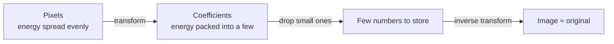

# 1. Images and transform coding

## A grayscale image is just a matrix

A 512×512 grayscale image is a 512×512 table of numbers. Each number is the brightness of one pixel: `0` is black, `255` is white.

```
  x →
y  52  55  61  66  70  61  64  73
↓  63  59  66  90 109  85  69  72
   62  59  68 113 144 104  66  73
   ...
```

In code, `services/image_io.py → decode_grayscale()` turns any uploaded file into exactly this: a `512×512` NumPy array of `float64` values from 0 to 255. Every image is converted to grayscale, center-cropped and resized to 512×512 so that:

- it splits evenly into 8×8 blocks (512 / 8 = 64), for the DCT,
- it can be halved 5 times (512 / 2⁵ = 16), for the Haar DWT.

## Why not just drop pixels?

Lossy compression means **storing fewer numbers** and accepting a slightly different image.

If you simply kept every 10th pixel, the image would become visibly broken, because **every pixel matters about equally**. We measured this on the cameraman image: the brightest 5 % of pixels hold only **11 %** of the image "energy" (the sum of squared values). Dropping pixels always throws away a lot.

## Transform coding: rewrite first, then drop

Idea: rewrite the same image with *different numbers* (coefficients) such that **a few numbers carry almost everything** and most are near zero. Then drop the near-zero ones.



Measured on cameraman (share of total energy held by the largest coefficients):

| Keep largest | Pixels (no transform) | DCT 8×8 | Haar, 3 levels |
|---:|---:|---:|---:|
| 1 % | 2.7 % | 93.0 % | 93.0 % |
| 5 % | 11.3 % | **99.76 %** | **99.73 %** |
| 10 % | 21.4 % | 99.89 % | 99.88 % |

This property is called **energy compaction**, and it is the whole reason DCT and DWT are used in JPEG and JPEG 2000.

## Why does a transform compact energy?

Natural images are **smooth most of the time**: neighbouring pixels are similar. A transform that describes "the average brightness here, plus small corrections" therefore needs only small numbers for the corrections. Both of our transforms do this, in different ways:

- **DCT** describes a block as a sum of smooth cosine waves. A smooth block needs only the slow waves.
- **Haar** describes the image as averages of pixel pairs plus their differences. In smooth areas the differences are ≈ 0.

## Two required properties

1. **Invertible**: from all coefficients we can get the exact image back. Our tests check `inverse(forward(x)) == x`.
2. **Orthonormal** (both of ours are): the transform only "rotates" the data and does not stretch it. As a result:
   - total energy is the same before and after (Parseval's theorem),
   - the error you introduce by dropping coefficients equals the energy of the dropped coefficients.
   So **"drop the smallest coefficients" is literally "make the smallest possible error"**, which justifies our compression rule.

## Checkpoint

- What is a grayscale image to a computer?
- Why is the input resized to 512×512, and why does 512 work for both methods?
- What is energy compaction, and why do we need it?
- Why is dropping small coefficients better than dropping pixels?
