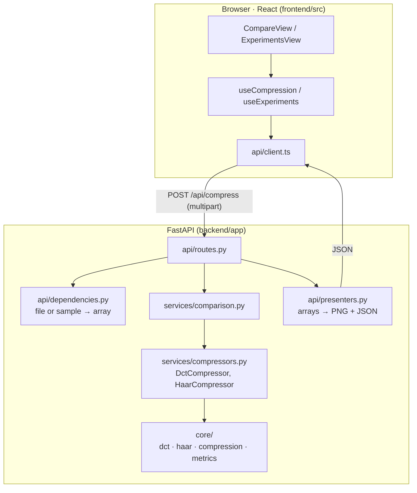
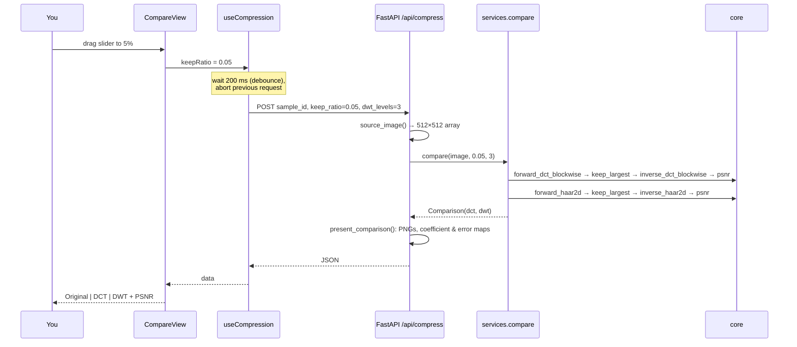

# 6. Code tour

## Layers



**Rule:** arrows only point down. `core` imports nothing from the project except `core`. You can show the teacher `core/dct.py` and `core/haar.py` on their own: they're about 100 lines each and contain all the math.

## What happens when you move the slider



## Key pieces of code to show

### The shared pipeline (`services/compressors.py`)

```python
def compress(compressor, image, keep_ratio):
    sparse = keep_largest(compressor.forward(image), keep_ratio)
    reconstruction = to_pixels(compressor.inverse(sparse.values))
    return CompressionResult(..., psnr=psnr(image, reconstruction), ...)
```

`DctCompressor` and `HaarCompressor` both implement the `Compressor` protocol (`forward`, `inverse`, `name`). Adding another wavelet means adding one class. This is the **Strategy** pattern.

### Why there are no loops over blocks

`split_into_blocks` reshapes 512×512 → (64, 64, 8, 8). Then `T @ blocks @ T.T` multiplies all 4,096 blocks at once, because NumPy broadcasts matrix multiplication over the leading dimensions.

### Why JSON has `null` PSNR

At 100 % the images are identical and PSNR = ∞. JSON can't represent infinity, so `presenters._finite_or_none` turns it into `null`, and the UI renders "∞".

## Frontend structure

| Folder | Role |
|---|---|
| `api/` | the only place that knows URLs. `types.ts` mirrors `schemas.py` field by field |
| `features/source` | sample thumbnails + upload; the selected source is stored in `App` and shared by both tabs |
| `features/compare` | the live comparison. `useCompression` debounces the slider and aborts stale requests |
| `features/experiments` | the sweep form, `PsnrChart` (Recharts), `ResultsTable` |
| `components/` | reusable, logic-free UI pieces |
| `lib/` | pure helpers: number formatting, log-scale slider maths, debounce |

The slider is **logarithmic** (`lib/keepScale.ts`): 0.1 %…100 % mapped as `10^x`, so the interesting 0.5–10 % range gets most of the slider's width.

## Tests (`backend/tests`)

| File | Proves |
|---|---|
| `test_dct.py` | `T·Tᵀ = I`; matches the textbook double-sum formula; perfect round trip; constant block → only DC |
| `test_haar.py` | known 1-D and 2×2 values; round trip for 1–5 levels; energy preserved |
| `test_compression.py` | exact count kept; magnitude not sign; 100 % is lossless; PSNR drops as k drops |
| `test_metrics.py` | PSNR formula, infinity case |
| `test_api.py` | endpoints, uploads of non-square RGB images, validation errors |
