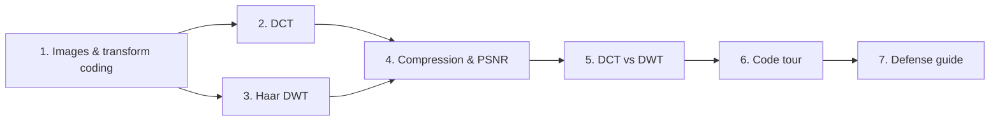
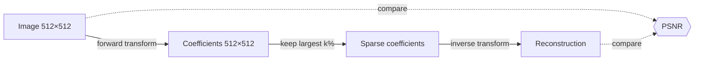

# Learning path

Read the chapters in order. Each takes 10–20 minutes. The **checkpoint** questions at the end of each chapter are exactly the kind of questions you'll get at the defense. If you can answer them out loud, move on.

| # | Chapter | You will understand | Code to open while reading |
|---|---|---|---|
| 1 | [Images and transform coding](01-images-and-transform-coding.md) | Why we transform before compressing, and what "energy compaction" means | `services/image_io.py` |
| 2 | [DCT — Discrete Cosine Transform](02-dct.md) | Cosine "building blocks", the matrix `T`, `C = T·B·Tᵀ`, why 8×8 | `core/dct.py`, `core/blocks.py` |
| 3 | [Haar DWT — wavelet transform](03-haar-dwt.md) | Averages and differences, sub-bands LL/HL/LH/HH, multiple levels | `core/haar.py` |
| 4 | [Compression and PSNR](04-compression-and-psnr.md) | How we throw information away, how we measure damage | `core/compression.py`, `core/metrics.py` |
| 5 | [DCT vs DWT](05-dct-vs-dwt.md) | Different artifacts, which is better when, our measured results | `reports/` |
| 6 | [Code tour](06-code-tour.md) | How a slider move travels through the whole system | the whole repo |
| 7 | [Defense guide](07-defense-guide.md) | A demo script and answers to likely questions | – |

## The whole lab in one picture

Both methods follow this exact pipeline. **Only the transform box is different**: DCT on 8×8 blocks, or Haar on the whole image.

## Practical exercises (do these in the app)

1. **Compare tab, cameraman**: move the slider from 100 % down to 0.5 %. Watch where the first visible damage appears in each method.
2. Switch the view to **Coefficients** at 5 %. Find the 8×8 grid in DCT and the sub-band pyramid in DWT.
3. Switch to **Error ×5**. The DCT error lines up with the block grid, and the DWT error follows edges.
4. Set Haar levels to 1, then to 5, at 1 %. Explain why the PSNR changes so much (chapter 5).
5. **Experiments tab**: run the default sweep and read the chart.
6. Upload your own photo and see whether the conclusions still hold.
