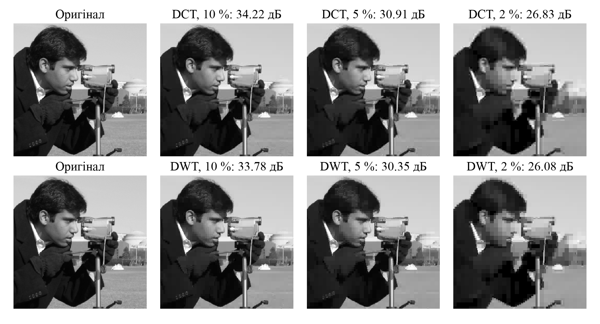

Київський національний університет імені Тараса Шевченка

Факультет комп'ютерних наук та кібернетики

ЗВІТ

з лабораторної роботи №3

з дисципліни «Розробка мультимедійних систем»

на тему: «Реалізація алгоритмів стиснення з втратами»

Виконав:

студент групи ІПС-42

Петриченко Павло

Київ – 2026

# Мета роботи

Власноруч реалізувати стиснення зображень із втратами на основі DCT (блоки 8×8,
матрична форма) та вейвлет-перетворення Хаара і порівняти їх за PSNR.

# Основні терміни

- **Перетворення** (DCT, DWT) – переписує блок пікселів іншими числами,
  *коефіцієнтами*, без втрати інформації: з коефіцієнтів можна точно повернути пікселі.
- **Коефіцієнт** – показує, наскільки сильно в зображенні присутній певний
  «візерунок»: плавна зміна, різкий перепад, дрібна текстура тощо.
- **Енергія** – сума квадратів значень, грубо кажучи, скільки «вмісту» несуть
  числа. Обидва перетворення *ортонормовані*: енергію не змінюють, тому помилка
  після стиснення дорівнює сумі квадратів відкинутих коефіцієнтів. Відкинули
  малі – помилка мала.
- **MSE** – середній квадрат різниці між пікселями оригіналу та результату.
  **PSNR** – та сама похибка в децибелах: чим більше, тим краще. Понад 40 дБ
  різницю не видно, менше 20 дБ – сильні спотворення.

# 1 Принцип роботи

Схема спільна: пряме перетворення → відкидання малих коефіцієнтів → обернене
перетворення. Перетворення концентрує енергію: 5 % найбільших коефіцієнтів DCT
містять 99,76 % енергії (5 % пікселів – лише 11,3 %), тому решту можна обнулити.

**DCT.** Зображення ділиться на блоки 8×8. Будується матриця $T$, рядки якої –
косинусоїди зростаючої частоти:

$$T_{0,x} = \sqrt{\tfrac{1}{N}}, \qquad T_{u,x} = \sqrt{\tfrac{2}{N}}\cos\frac{(2x+1)u\pi}{2N}, \qquad N = 8.$$

Для кожного блоку $B$:

$$C = T\,B\,T^{\mathsf T}, \qquad B = T^{\mathsf T}\,C\,T.$$

Множення на $T$ зліва перетворює стовпці, на $T^{\mathsf T}$ справа – рядки.
Оскільки $T T^{\mathsf T} = I$, для оберненого перетворення достатньо транспонування.
Коефіцієнт $C_{0,0}$ – середня яскравість блоку (×8), решта описують дедалі
дрібніші деталі.

**DWT Хаара.** Один крок замінює кожну пару сусідніх значень на середнє та різницю:

$$a = \frac{x_0 + x_1}{\sqrt 2}, \quad d = \frac{x_0 - x_1}{\sqrt 2}; \qquad x_0 = \frac{a + d}{\sqrt 2}, \quad x_1 = \frac{a - d}{\sqrt 2}.$$

Крок застосовується до рядків, потім до стовпців. Виходить зменшена копія LL і
деталі HL, LH, HH (межі). Наступні рівні повторюють це для LL, обернене
перетворення йде у зворотному порядку.

**Стиснення та якість.** Для обох методів зберігається задана частка
коефіцієнтів із найбільшим модулем, решта обнуляється. Частку змінює
повзунок у програмі. Якість оцінюється за

$$\mathrm{PSNR} = 10\log_{10}\frac{255^2}{\mathrm{MSE}}\ \text{дБ},$$

Коефіцієнт стиснення = усі коефіцієнти / ненульові.

# 2 Результати

Зображення cameraman 512×512, DWT – 3 рівні (для порівняння також 5).

Таблиця 1 – PSNR (дБ) залежно від частки збережених коефіцієнтів

| Частка, % | Стиснення | DCT 8×8 | Хаар, 3 рівні | Хаар, 5 рівнів |
|---:|---:|---:|---:|---:|
| 20 | 5:1 | **39,70** | 39,44 | 39,68 |
| 10 | 10:1 | **34,22** | 33,78 | 34,16 |
| 5 | 20:1 | 30,91 | 30,35 | **30,96** |
| 2 | 50:1 | 26,83 | 26,08 | **28,09** |
| 1 | 100:1 | 16,24 | 16,24 | **26,25** |

<figure>

<figcaption>Рисунок 1 – Оригінал, DCT і DWT (3 рівні) за різних рівнів стиснення (фрагмент)</figcaption>
</figure>

# Висновки

1. За помірного стиснення DCT і Хаар майже рівні (різниця до 0,8 дБ), DCT трохи
   краще завдяки гладкому базису. DCT дає сітку блоків 8×8, Хаар – сходинки.
2. За 1 % обидва дають рівно 16,24 дБ: LL при 3 рівнях – це ті самі 4096 середніх
   блоків 8×8, що й DC-коефіцієнти DCT, і 2621 коефіцієнта не вистачає навіть на них.
3. За сильного стиснення виграє глибший вейвлет-розклад: з 5 рівнями 26,25 дБ
   проти 16,24 дБ у DCT за 1 %.
